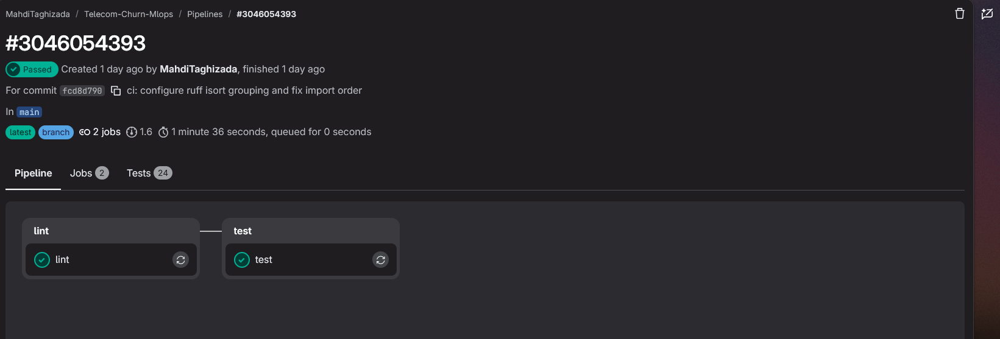
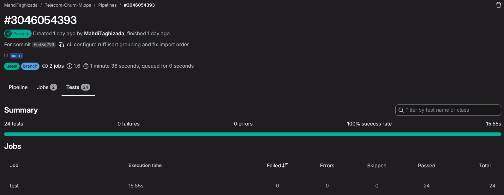

# Telecom Churn MLOps

## Overview

This repository is a small, reproducible MLOps project for estimating telecom
customer churn risk. It covers data validation, leakage-safe training, MLflow
tracking and Registry, a FastAPI service, Docker packaging, GitLab CI tests,
data-drift reports, and Prometheus-format application metrics.

The model is decision support, not an automatic business decision. The source
is IBM's public Telco Customer Churn sample dataset. It contains synthetic
company data, not internal operator data or real customer records. The target
is `Churn` (`Yes`/`No`); `customerID` is excluded from model features.

## Status

The latest verified GitLab CI pipeline is
[pipeline #3046054393](https://gitlab.com/MahdiTaghizada/telecom-churn-mlops/-/pipelines/3046054393)
for commit `fcd8d790`. It passed in 1 minute 36 seconds with both `lint` and
`test` jobs passing and 24 tests reported successfully.

- GitLab: <https://gitlab.com/MahdiTaghizada/telecom-churn-mlops>
- GitHub: <https://github.com/MahdiTaghizada/Telecom-Churn-MLOps>

The pipeline runs lint and tests only; it does not publish or deploy an image.

## Reproducible setup

### Prerequisites

- Python 3.13
- `uv`
- Docker Desktop, only for container verification
- Internet access for the first dataset download; later runs can use the
  existing raw CSV

PowerShell on a new computer:

```powershell
git clone <repository-url>
Set-Location Telecom-Churn-MLOps
uv sync --frozen
uv run python -m telecom_churn.train
uv run pytest -q
uv run ruff check .
uv run python -m telecom_churn.drift
```

Training downloads the CSV only when
`data/raw/Telco-Customer-Churn.csv` is absent, validates it, trains both
models, updates local MLflow, writes reports, and exports `models/champion/`.

## Results

The latest measured values are recorded in
[reports/model_comparison.json](reports/model_comparison.json):

| Model | Validation F1 | Test Accuracy | Test Precision | Test Recall | Test F1 | Test ROC-AUC |
|---|---:|---:|---:|---:|---:|---:|
| Logistic Regression (selected) | 0.6237 | 0.7374 | 0.5034 | 0.7834 | 0.6130 | 0.8415 |
| Random Forest | 0.6081 | not selected | not selected | not selected | not selected | not selected |

Model selection used validation F1 rather than Accuracy alone. Held-out test
metrics were calculated only after selection.

## MLflow and Registry

```powershell
uv run mlflow ui --backend-store-uri sqlite:///mlflow/mlflow.db
```

The experiment is `telecom-churn-stage-1`. The project author's recorded local
training run used `telecom-churn-model`, version `6`, with the `champion` alias.
The `mlflow/` directory is local-only and is not stored in Git, so the MLflow
UI is empty before training on a new checkout. Training creates a new local
tracking database; the first Registry version starts at `1` and increases on
repeated training runs. The committed `models/champion/` bundle is separate
from that database and is the artifact used by the API.

## API

```powershell
uv run uvicorn telecom_churn.api:app --host 127.0.0.1 --port 8000
```

Endpoints are `GET /health`, `POST /predict`, `GET /model-info`, and
`GET /metrics`. Swagger is available at
`http://127.0.0.1:8000/docs`.

Example request:

```json
{"SeniorCitizen":0,"tenure":1,"MonthlyCharges":29.85,"TotalCharges":29.85,
"gender":"Female","Partner":"Yes","Dependents":"No","PhoneService":"No",
"MultipleLines":"No phone service","InternetService":"DSL","OnlineSecurity":"No",
"OnlineBackup":"Yes","DeviceProtection":"No","TechSupport":"No",
"StreamingTV":"No","StreamingMovies":"No","Contract":"Month-to-month",
"PaperlessBilling":"Yes","PaymentMethod":"Electronic check"}
```

Real response from the local API:

```json
{
  "prediction": "Yes",
  "churn_probability": 0.8007603116595001,
  "model_name": "telecom-churn-model",
  "model_version": "6"
}
```

Send a request from a JSON file with `curl.exe`:

```powershell
Set-Content -Path api-request.json -Value @'
{"SeniorCitizen":0,"tenure":1,"MonthlyCharges":29.85,"TotalCharges":29.85,"gender":"Female","Partner":"Yes","Dependents":"No","PhoneService":"No","MultipleLines":"No phone service","InternetService":"DSL","OnlineSecurity":"No","OnlineBackup":"Yes","DeviceProtection":"No","TechSupport":"No","StreamingTV":"No","StreamingMovies":"No","Contract":"Month-to-month","PaperlessBilling":"Yes","PaymentMethod":"Electronic check"}
'@ -NoNewline
curl.exe -X POST http://127.0.0.1:8000/predict `
  -H "Content-Type: application/json" `
  --data-binary "@api-request.json"
Remove-Item api-request.json
```

Categorical unknown values are accepted by
`OneHotEncoder(handle_unknown="ignore")`; malformed or extra fields are
rejected. `/metrics` exposes HTTP requests, request duration, HTTP errors,
prediction count, and inference duration with low-cardinality route/status
labels.

## Docker

```powershell
docker build -t telecom-churn-api .
docker run -d --name churn-api-final -p 8013:8000 telecom-churn-api
curl.exe http://127.0.0.1:8013/health
curl.exe http://127.0.0.1:8013/model-info
curl.exe -X POST http://127.0.0.1:8013/predict `
  -H "Content-Type: application/json" `
  --data-binary "@api-request.json"
docker stop churn-api-final
docker rm churn-api-final
```

## GitLab CI

The pipeline runs on every push to `main`. It contains only `lint` and `test`
jobs; JUnit results are visible in the GitLab Tests tab. It does not publish or
deploy an image.





Pipeline history:

- Pipeline `#3045942253` for commit `48fed4d6` failed in `lint` because of
  import-order (`I001`) errors; `test` was skipped.
- Pipeline `#3046054393` for commit `fcd8d790` passed after the Ruff isort
  grouping configuration and import-order fixes. It reported 24 tests with
  0 failures, 0 errors, and a 100% success rate.

## Data drift

```powershell
uv run python -m telecom_churn.drift
```

This creates HTML and JSON reports under `reports/drift/`, including a control
report and a `SYNTHETIC` drift report. Reference data is the feature-only
training split. Control current data is sampled from the same distribution;
synthetic current data deliberately changes `MonthlyCharges`, `tenure`,
`Contract`, and `PaymentMethod`. Numeric features use two-sample KS and
categorical features use chi-square with `p < 0.05`.

Data drift is not concept drift and does not, by itself, prove worse model
quality. New labeled data requires a separate evaluation.

## Limitations

The dataset is synthetic and may not represent a production operator. Bias and
fairness across groups were not comprehensively evaluated. Drift metrics do not
measure model quality. Grafana dashboard and cloud deployment are not included.
The real pipeline failure was an import-order lint failure; a deliberately
broken pytest test demo was not performed. The pipeline therefore documents
test execution and failure-on-lint behavior, but not a separate pytest-failure
demonstration.

## Future work

Potential next steps are threshold and calibration analysis, fairness
evaluation, Grafana/alerting integration, cloud deployment, live labeled
feedback, and a separately governed retraining workflow.

See [docs/DATASET.md](docs/DATASET.md),
[docs/MODEL_CARD.md](docs/MODEL_CARD.md),
[docs/ARCHITECTURE.md](docs/ARCHITECTURE.md), and
[docs/CODE_WALKTHROUGH.az.md](docs/CODE_WALKTHROUGH.az.md).
