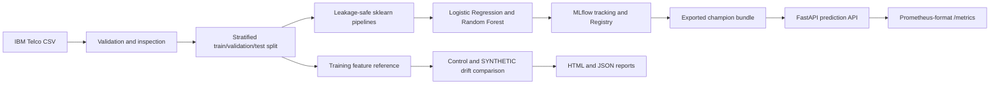

# Architecture

Training fits preprocessing only on the training partition. The selected
pipeline is registered in MLflow and exported locally so the API does not need
an MLflow server at inference time. The drift utility uses the same
deterministic split to reconstruct the feature-only training reference.

The MVP intentionally does not include Airflow, automatic retraining, cloud
deployment, or a Grafana dashboard.
